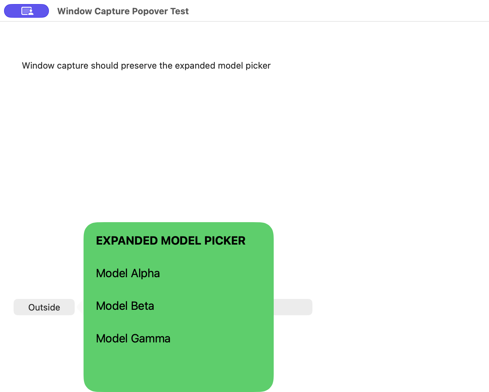

# 窗口截图保留弹窗：测试与交付报告

## 范围与当前结论

- 日期：2026-10-26，Asia/Shanghai。
- 环境：macOS 26.6.2（25G83）、Xcode 27.1（27A9275）、arm64；内屏 1710×1107 点 / 2×，另接外屏。
- 基线：main / `8ff8d5d43c6c8d0309459899caf970344ce77037`，测试时本次改动未提交。工作区原有两份 window-capture-isolation 报告的删除不纳入本次变更。
- BUG-01：窗口截图时，展开的模型选择框随原应用失去焦点而收起，导出图遗漏弹窗。
- 当前结论：213 项自动化测试、Release 构建、签名、完整安装、固定路径启动和用户实际截图验收全部通过。修复代码已提交并推送，远端 SHA 核对一致。

## 复现、根因与修复

- 建立协调器行为回归：模拟弹窗在截图浮层取焦点时关闭，窗口内原本绿色的弹窗区域变成红色宿主背景，验证最终剪贴板 PNG 的实际像素。
- 修改前命令退出 65，`testWindowCapturePreservesPopoverPixelsWhenOverlayDismissesLivePopover` 失败；绿色分量实际 `0.14910030364990234`，不满足 `> 0.9`；红色分量 `1.0`，不满足 `< 0.1`。此为修改前预期失败证据。
- 根因：`OverlayController.present` 激活 Wnip；窗口隔离采集直到用户点击目标窗口才执行，此时瞬态弹窗已关闭。原采集另外使用独立窗口过滤器并显式设置 `includeChildWindows = false`。
- 修复：在浮层显示前冻结当前前台应用的窗口，选窗与导出复用同一快照；其他应用仍按需隔离采集。快照失败不降级成桌面截图，也不在弹窗关闭后重新采集冒充成功。
- 系统取图改用显示器上的单窗口包含过滤器，启用子窗口，显式指定整个显示器的 `sourceRect` 以保留坐标；只采选定窗口及其子窗口，不混入其他应用或同应用的独立窗口。扫描透明通道得到宿主与弹窗共同边界，选区随之扩展，保留越出宿主边缘的弹窗。
- API 依据：[Apple SCStreamConfiguration.includeChildWindows](https://developer.apple.com/documentation/screencapturekit/scstreamconfiguration/includechildwindows)；本机 SDK 说明该开关适用于显示器上的窗口/应用过滤器。
- 实际探针发现：未显式设置 `sourceRect` 时图像被移至左上角；补充后宿主位置、尺寸恢复到 `(240, 180, 720, 532)` 点 / `1440×1064` 像素。此问题已在完整测试前修正。
- 未取得旧安装的失败截图：界面工具连接无主窗口的菜单栏 Wnip 超时；保留实际回归失败证据。系统弹窗检查使用仅含测试文字的临时 AppKit fixture，不读取私人对话。

## 自动化验证

| 检查 | 实际结果 |
| --- | --- |
| 修改前弹窗像素回归 | 失败，退出 65，确认能检测 BUG-01 |
| 修改后同一回归 | 1 项通过，0 失败、0 跳过 |
| 完整测试 | 213 项通过，0 失败；XCTest 实测 2.124 秒，xcodebuild 退出 0 |
| 新增协调器回归 | 弹窗像素保留；仅冻结前台应用；扩展选区；快照失败不错误导出；取消冻结不覆盖新会话 |
| 新增图像边界回归 | Retina / 负坐标屏幕上越界弹窗与方向正确、空白处透明；无弹窗保留宿主边界；全透明结果报错 |
| 原有回归 | 窗口隔离、显示器坐标、标注、复制/保存、贴图与其他原有用例全部通过 |

实际命令（工作目录为仓库根目录）：

```sh
xcodebuild test -quiet -project Wnip.xcodeproj -scheme Wnip \
  -configuration Debug -destination 'platform=macOS,arch=arm64' \
  -derivedDataPath DerivedData CODE_SIGNING_ALLOWED=NO \
  -only-testing:WnipTests/CaptureCoordinatorTests/testWindowCapturePreservesPopoverPixelsWhenOverlayDismissesLivePopover
xcodebuild test -project Wnip.xcodeproj -scheme Wnip \
  -configuration Debug -destination 'platform=macOS,arch=arm64' \
  -derivedDataPath DerivedData CODE_SIGNING_ALLOWED=NO \
  -resultBundlePath /tmp/wnip-popover-full-20261026.xcresult
```

日志：`/tmp/wnip-popover-red.log`、`/tmp/wnip-popover-green.log`、`/tmp/wnip-popover-full.log`。完整结果包：`/tmp/wnip-popover-full-20261026.xcresult`。

## 构建、签名与安装

- Release 构建退出 0：`xcodebuild build -quiet -project Wnip.xcodeproj -scheme Wnip -configuration Release -destination 'platform=macOS,arch=arm64' -derivedDataPath DerivedData CODE_SIGNING_ALLOWED=YES`；产物 `DerivedData/Build/Products/Release/Wnip.app`，arm64。日志 `/tmp/wnip-popover-build.log`。
- 新旧签名完整性、designated requirement 一致性、产物对旧版 DR 的兼容性与 entitlements 一致性均通过。沿用固定 Apple Development 身份和 Team；未更换证书、重置授权或修改配置。
- 旧进程 PID 53739，实际路径 `/Applications/Wnip.app/Contents/MacOS/Wnip`；经 `NSRunningApplication.terminate()` 正常退出，安装前确认无 Wnip 残留，无需强制终止。
- 取消 2 个其他 Wnip 副本的系统注册。旧应用移入废纸篓备份，使用 `ditto` 完整复制本次产物到 `/Applications/Wnip.app`，随后签名及旧版 DR 校验通过，主可执行文件与当前产物逐字节一致。
- 已安装可执行文件 SHA-256：`92a8578f8ffd43edf8f4af57206cf6f1f666eee854f2f30f49ab13e2e675a404`。安装证据 `/tmp/wnip-popover-install-result.json`。

## 启动、权限与实际功能

- 通过 `open /Applications/Wnip.app` 启动，新进程 PID 85608。`proc_pidpath` 核实 `/Applications/Wnip.app/Contents/MacOS/Wnip`，后续存活检查、安装签名与可执行文件哈希复查通过。
- 真实系统采集探针直接编译本次生产采集代码，对临时 AppKit fixture 的 NSPopover 取图。宿主窗口 `(600, 180, 720, 532)` 点；弹窗越出底边后，隔离截图边界为 `(600, 135, 720, 577)` 点 / `1440×1154` 像素，弹窗全部选项与四边完整，宿主圆角正确，空白处透明。
- 同一 fixture 的另一个独立蓝色窗口 `(850, 400, 200, 150)` 点覆盖宿主，隔离结果没有蓝色窗口像素。已实际查看完整图像并保留证据；此为生产代码探针结果，不冒充已安装应用操作验收。



图 1：浅色模式、2× Retina，完整宿主与越界弹窗，透明处在预览中呈黑色。仅含生成的测试文字，无私人内容。

- 布局与设置界面未修改；本次实际样式检查覆盖宿主/弹窗边界、圆角和越界内容完整性。未改动的设置、滚动及最小尺寸不重复验收。
- 界面自动化连接无主窗口的菜单栏 Wnip 超时；工具禁止访问聊天客户端 UI，因此自动检查使用无私人内容的独立 fixture。用户在新安装版本保持 ChatGPT 模型菜单展开，按 `⌘⇧W`、点主窗口空白处、Return 复制后检查菜单完整性，明确回复：**“模型列表已完整保留”**。BUG-01 实际操作验收通过，也验证了新安装应用截图所需的屏幕录制能力可用；未单独断言系统是否曾再次显示权限提示。
- 用户确认后再次核对 PID 85608 仍从固定路径运行，安装签名、旧版 DR 兼容性及与当前构建产物的逐字节一致性均通过。保留应用运行以便后续使用。

## 审查、Git 与遗留事项

- 已审查本次最终代码 diff，检查取消、失败、隔离与坐标路径，并增加相应回归；未委派其他代理。未发现需继续修改的问题。
- 修复提交：`65523c025029ca6302aa7dbaca53257e289aa1dc`，直接位于 `main`，无需分支合并。已执行 `git push origin main`，`git ls-remote origin refs/heads/main` 返回相同 SHA。
- 本报告及无私人内容的测试图随后以独立文档提交收尾，不改变已经验证、安装和运行的应用源码；最终远端提交另在交付回复中给出。
- 原有两份报告的删除保持为未提交状态，没有夹带进本次修复提交。未发布 release。
- 无待人工验收或其他交付阻塞。限制：未取得已安装应用的前后截图，实际使用效果依据用户操作确认；图 1 为生产采集代码的系统探针图。报告图片链接与 PNG 文件已校验并实际查看，报告 Markdown 整体渲染未单独预览。
